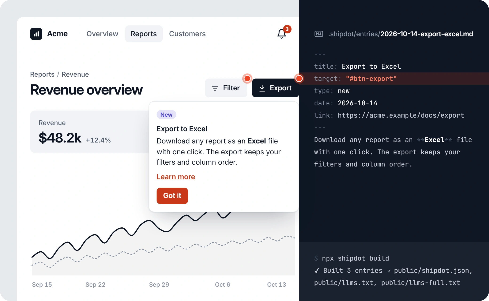
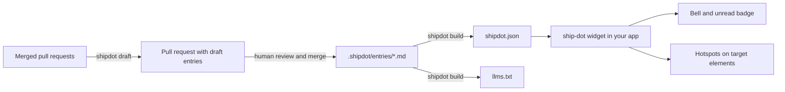
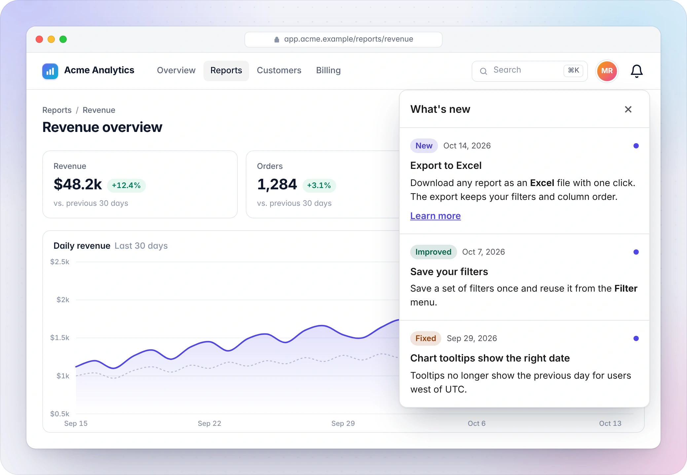

<p align="center">
  <a href="README_es.md">🇪🇸 Leer en español</a>
</p>

<p align="center">
  <picture>
    <source media="(prefers-color-scheme: dark)" srcset=".github/assets/logo-dark.svg">
    
  </picture>
</p>

<p align="center">
  <strong>Announce new features right where they live.</strong><br>
  In-app changelog and feature hotspots generated from your pull requests. Zero backend, tiny web component.
</p>

<p align="center">
  <a href="https://github.com/pipe1os/shipdot/actions/workflows/ci.yml"></a>
  <a href="LICENSE"></a>
  <a href="https://www.npmjs.com/package/shipdot"></a>
  <a href="https://bundlephobia.com/package/shipdot"></a>
</p>

<p align="center">
  <a href="https://pipe1os.github.io/shipdot/">Docs</a> ·
  <a href="https://pipe1os.github.io/shipdot/playground/">Playground</a> ·
  <a href="https://pipe1os.github.io/shipdot/getting-started/">Getting started</a> ·
  <a href="packages/shipdot/CHANGELOG.md">Changelog</a>
</p>

<p align="center">
  <picture>
    <source media="(prefers-color-scheme: dark)" srcset=".github/assets/hero-dark.webp">
    
  </picture>
</p>

---

**shipdot** shows your users what changed, inside your app: a bell with an unread count, a "What's new" panel, and **hotspots**, pulsing dots on the exact buttons a new feature lives in. Updates are Markdown files in your repository, drafted from your merged pull requests and reviewed like code. There is no server, database, account or tracking.

> [!NOTE]
> shipdot is young (`0.x`). The `shipdot.json` format is versioned and stable; the widget, CLI and Action may still change between minor versions. Every change is in the [changelog](packages/shipdot/CHANGELOG.md).

## Why shipdot

- **Hotspots on the real UI.** An entry with `target: "#btn-export"` puts a pulsing dot on that button. Telling users a feature exists is good; pointing at it is better. Hotspots follow their target on scroll and resize, wait for elements rendered late in SPAs, and hide when the target is hidden.
- **Git-native, reviewed by a human.** `shipdot draft` turns merged pull requests into notes written for end users and opens a pull request. You fix the wording, merge, ship.
- **Multi-language from day one.** `entry.es.md` next to `entry.md`. The widget picks the user's language, falls back per entry, and ships its UI strings in English, Spanish and Portuguese.
- **Nothing to run or pay for per user.** A static `shipdot.json` and a web component under 7 KB min+gzip. No backend and no telemetry: your announcements stay in your repository, and read state stays in your users' browsers.

## Features

- **Feed panel** as a popover, drawer or modal, with an unread badge.
- **Drafts from pull requests**: offline template mode, or rewrite and translate with your own LLM key (Anthropic or any OpenAI-compatible API).
- **GitHub Action** that opens a pull request with new drafts every week.
- **Zero runtime dependencies**, Shadow DOM, and a 10 KB min+gzip budget enforced in CI.
- **Accessible**: keyboard navigation, focus management, WCAG 2.1 AA contrast in light and dark themes, checked with axe.
- **`llms.txt` and `llms-full.txt`** so AI assistants know what changed.
- **Themeable** with CSS custom properties, `::part()` and your own trigger.

## Quick start

You need Node.js 24 or newer for the CLI. The widget runs in any [modern browser](#browser-support).

**1. Create the config and a first entry**

```bash
npx @shipdot/cli init
```

**2. Write entries and build the feed**

Each update is a Markdown file in `.shipdot/entries/`, for example `.shipdot/entries/2026-10-14-export-excel.md`:

```md
---
date: 2026-10-14
type: new             # new | improved | fixed
title: Export to Excel
target: "#btn-export" # optional: hotspot on this element
---
You can now export any report to Excel with one click.
```

```bash
npx @shipdot/cli build   # → public/shipdot.json, public/llms.txt, public/llms-full.txt
```

**3. Add the widget**

```html
<script type="module" src="https://unpkg.com/shipdot@0.1"></script>
<ship-dot src="/shipdot.json"></ship-dot>
```

Or `npm install shipdot` and `import 'shipdot'` once on the client. Try it without installing anything in the **[playground](https://pipe1os.github.io/shipdot/playground/)**.

## How it works



HTML is sanitized once, at build time, with a strict allowlist, so the widget stays tiny and never parses untrusted Markdown. The decisions behind the design are in [`docs/adr`](docs/adr).

## Widget

<p align="center">
  <picture>
    <source media="(prefers-color-scheme: dark)" srcset=".github/assets/panel-dark.webp">
    
  </picture>
</p>

```html
<ship-dot
  src="/shipdot.json"
  mode="popover"
  locale="es"
  theme="auto"
  max-hotspots="3"
  first-visit="mark-read"
  storage-key="default"
></ship-dot>
```

| Attribute | Default | Description |
| --- | --- | --- |
| `src` | required | URL of `shipdot.json`. The only request the widget makes. |
| `mode` | `popover` | `popover`, `drawer` or `modal`. |
| `locale` | `navigator.languages` | Language to show, with fallback to the feed's default. |
| `theme` | `auto` | `light`, `dark` or `auto`. |
| `hotspots` | on | `off` disables hotspots. |
| `max-hotspots` | `3` | Hotspots visible at once. |
| `first-visit` | `mark-read` | `mark-read` (existing entries count as read) or `show-latest`. |
| `storage-key` | `default` | Read state key: `localStorage["shipdot:<key>"]`. |

**Methods**: `open()`, `close()`, `markAllRead()`, `replayLatest()`, `refresh()`.
**Events** (bubbling, composed `CustomEvent`s): `shipdot:ready`, `shipdot:open`, `shipdot:close`, `shipdot:read`, `shipdot:hotspot-click`, `shipdot:error`.
**Styling**: CSS custom properties (`--shipdot-accent`, `--shipdot-hotspot`, `--shipdot-bg`…), `::part()` on every key piece, and a default slot for your own trigger.

Full reference: [widget](https://pipe1os.github.io/shipdot/reference/widget/) · [theming](https://pipe1os.github.io/shipdot/guides/theming/) · [hotspots](https://pipe1os.github.io/shipdot/guides/hotspots/).

## CLI

| Command | What it does |
| --- | --- |
| `shipdot init` | Creates `shipdot.config.json` and an example entry. Never overwrites. |
| `shipdot build` | Validates entries, renders sanitized HTML, writes `shipdot.json`, `llms.txt`, `llms-full.txt` and copies relative images. |
| `shipdot validate` | Prints `file:line:column` errors (duplicate IDs, bad dates, unknown types, orphan translations, undeclared locales…). Exit code 1 on errors. |
| `shipdot draft` | Drafts entries from PRs merged since the last tag. `--dry-run`, `--since`, `--base`, `--repo`, `--no-llm`. |

Full reference: [CLI](https://pipe1os.github.io/shipdot/reference/cli/) · [config](https://pipe1os.github.io/shipdot/reference/config/) · [feed format](https://pipe1os.github.io/shipdot/reference/feed/).

## GitHub Action

```yaml
# .github/workflows/shipdot.yml
name: shipdot
on:
  workflow_dispatch:
  schedule:
    - cron: '0 9 * * 1' # Mondays 09:00 UTC
permissions:
  contents: read
jobs:
  draft:
    runs-on: ubuntu-latest
    permissions:
      contents: write
      pull-requests: write
    steps:
      - uses: actions/checkout@v7
      - uses: pipe1os/shipdot@v0
        with:
          command: draft
          # llm-provider: anthropic
          # llm-api-key: ${{ secrets.SHIPDOT_LLM_API_KEY }}
```

> [!IMPORTANT]
> Enable **Settings → Actions → General → Allow GitHub Actions to create and approve pull requests** so the Action can open the draft pull request.

| Input | Default | Description |
| --- | --- | --- |
| `command` | `draft` | `draft` opens a pull request with new drafts; `build` writes `shipdot.json` and `llms.txt`. |
| `github-token` | `${{ github.token }}` | Token for the GitHub API. |
| `base-branch` | config, then repo default | Branch the pull requests are merged into. |
| `llm-provider`, `llm-api-key`, `llm-model`, `llm-base-url` | — | Optional [LLM mode](#llm-mode-and-privacy). Pass the key from a secret; it is masked in logs. |
| `working-directory` | `.` | Folder with `shipdot.config.json`. |

Outputs: `entries`, `pull-request-url`, `pull-request-number`. More in the [Action guide](https://pipe1os.github.io/shipdot/guides/github-action/).

## Writing notes in pull requests

Add a `### shipdot` section to your PR template and the note is written by the person who knows the change best:

```md
### shipdot
title: Export to Excel
type: new
target: "#btn-export"

You can now export any report to Excel with one click.
```

Write `skip` to opt a PR out. PRs labeled `skip-shipdot`, bot PRs and `chore`/`ci`/`test`/`docs`/`refactor` PRs are skipped automatically.

## LLM mode and privacy

Template mode works offline. To let a model rewrite drafts in user language and translate them, bring your own key:

```bash
SHIPDOT_LLM_PROVIDER=anthropic SHIPDOT_LLM_API_KEY=... npx @shipdot/cli draft
```

`SHIPDOT_LLM_PROVIDER` is `anthropic` or `openai-compatible` (with `SHIPDOT_LLM_BASE_URL` and `SHIPDOT_LLM_MODEL`, for example a local Ollama). Requests use plain `fetch`, no SDKs.

**Only the pull request title and body are sent**, never diffs, code, file names, comments or author data. PR text is treated as untrusted: it is wrapped in escaped delimiters, the system prompt forbids following instructions inside it, and the reply must pass schema validation or the PR falls back to template mode. Every draft is reviewed by a human before it ships. Details: [Drafting guide](https://pipe1os.github.io/shipdot/guides/drafting/#what-is-sent-exactly).

## Internationalization

```json
{ "defaultLocale": "en", "locales": ["en", "es", "pt"] }
```

Add `2026-10-14-export-excel.es.md` with a translated `title` and body. The widget uses the `locale` attribute or `navigator.languages`, matches `es-CL` → `es`, and falls back to the default locale per entry. [i18n guide](https://pipe1os.github.io/shipdot/guides/i18n/).

## Frameworks

Works anywhere custom elements do. Guides and typed JSX/template support for [React](https://pipe1os.github.io/shipdot/frameworks/react/), [Vue](https://pipe1os.github.io/shipdot/frameworks/vue/), [Svelte](https://pipe1os.github.io/shipdot/frameworks/svelte/), [Astro](https://pipe1os.github.io/shipdot/frameworks/astro/), [Next.js](https://pipe1os.github.io/shipdot/frameworks/next/) and [vanilla JS](https://pipe1os.github.io/shipdot/frameworks/vanilla/). Runnable apps live in [`examples/`](examples).

```ts
import 'shipdot'
import type {} from 'shipdot/react' // or shipdot/vue, shipdot/svelte, shipdot/astro
```

## Browser support

Chrome and Edge 123+, Firefox 125+, Safari 17.5+ (Popover API, `<dialog>`, `light-dark()`). Importing the module during server-side rendering is safe.

## FAQ

<details>
<summary><strong>Why is nothing unread on my first visit?</strong></summary>

A first visit marks existing entries as read, so new users aren't greeted by your whole history. Use `first-visit="show-latest"` or clear `localStorage["shipdot:default"]`.
</details>

<details>
<summary><strong>Is the HTML in entries safe?</strong></summary>

`shipdot build` sanitizes it with an allowlist (no scripts, iframes, styles, event handlers or `javascript:` URLs), tested against common XSS vectors. The widget trusts `shipdot.json`, so serve it from your own site.
</details>

<details>
<summary><strong>Can I use it without GitHub?</strong></summary>

Yes. `init`, `build` and `validate` only read local files. Only `draft` and the Action talk to GitHub.
</details>

<details>
<summary><strong>Can I open the panel from my own menu?</strong></summary>

Put your own element inside `<ship-dot>` (it replaces the bell) or call `document.querySelector('ship-dot').open()`.
</details>

More in the [FAQ](https://pipe1os.github.io/shipdot/faq/).

## Roadmap

Not in the MVP, planned as opt-in features: analytics, segmentation by user or plan, A/B tests, RSS/Atom output, publishing to Slack, Discord and email, a web admin panel, and read-state sync across devices. See [`PLAN.md`](PLAN.md#post-mvp--roadmap) and share ideas in [Discussions](https://github.com/pipe1os/shipdot/discussions).

## Contributing

Contributions are welcome! Read [CONTRIBUTING.md](CONTRIBUTING.md) for the setup (`pnpm install && pnpm build && pnpm test`), conventions and review process. Please follow the [Code of Conduct](CODE_OF_CONDUCT.md) and report security issues privately as described in [SECURITY.md](SECURITY.md).

## License

[MIT](LICENSE) © 2026 pipe1os and shipdot contributors
