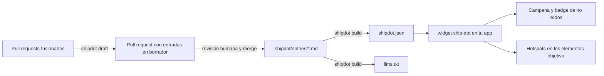

<p align="center">
  <a href="README.md">🇺🇸 Read in English</a>
</p>

<p align="center">
  <picture>
    <source media="(prefers-color-scheme: dark)" srcset=".github/assets/logo-dark.svg">
    
  </picture>
</p>

<p align="center">
  <strong>Anuncia las funciones nuevas justo donde viven.</strong><br>
  Changelog dentro de la app y hotspots de funciones generados a partir de tus pull requests. Cero backend, un web component muy pequeño.
</p>

<p align="center">
  <a href="https://github.com/pipe1os/shipdot/actions/workflows/ci.yml"></a>
  <a href="LICENSE"></a>
  <a href="https://www.npmjs.com/package/shipdot"></a>
  <a href="https://bundlephobia.com/package/shipdot"></a>
</p>

<p align="center">
  <a href="https://pipe1os.github.io/shipdot/">Documentación</a> ·
  <a href="https://pipe1os.github.io/shipdot/playground/">Playground</a> ·
  <a href="https://pipe1os.github.io/shipdot/getting-started/">Primeros pasos</a> ·
  <a href="packages/shipdot/CHANGELOG.md">Registro de cambios</a>
</p>

<p align="center">
  <picture>
    <source media="(prefers-color-scheme: dark)" srcset=".github/assets/hero-dark.webp">
    
  </picture>
</p>

---

**shipdot** muestra a tus usuarios qué cambió, dentro de tu app: una campana con un contador de no leídos, un panel "What's new" y **hotspots**, puntos pulsantes sobre los botones exactos donde vive una función nueva. Las actualizaciones son archivos Markdown en tu repositorio, redactados a partir de tus pull requests fusionados y revisados como código. No hay servidor, base de datos, cuenta ni rastreo.

> [!NOTE]
> shipdot es joven (`0.x`). El formato de `shipdot.json` está versionado y es estable; el widget, la CLI y la Action todavía pueden cambiar entre versiones menores. Todos los cambios están en el [registro de cambios](packages/shipdot/CHANGELOG.md).

## Por qué shipdot

- **Hotspots en la interfaz real.** Una entrada con `target: "#btn-export"` pone un punto pulsante en ese botón. Avisar a los usuarios de que existe una función está bien; señalarla es mejor. Los hotspots siguen a su elemento objetivo al hacer scroll y al cambiar el tamaño, esperan a los elementos que se renderizan tarde en las SPA y se ocultan cuando el objetivo queda oculto.
- **Nativo de Git, revisado por una persona.** `shipdot draft` convierte los pull requests fusionados en notas escritas para usuarios finales y abre un pull request. Corriges la redacción, haces merge y lanzas.
- **Varios idiomas desde el primer día.** `entry.es.md` junto a `entry.md`. El widget elige el idioma del usuario, recurre al idioma por defecto en cada entrada y trae sus textos de interfaz en inglés, español y portugués.
- **Nada que ejecutar ni pagar por usuario.** Un `shipdot.json` estático y un web component de menos de 7 KB min+gzip. Sin backend ni telemetría: tus anuncios se quedan en tu repositorio, y el estado de lectura, en el navegador de tus usuarios.

## Funciones

- **Panel de feed** como popover, drawer o modal, con un badge de no leídos.
- **Borradores a partir de pull requests**: modo de plantilla sin conexión, o reescritura y traducción con tu propia clave de LLM (Anthropic o cualquier API compatible con OpenAI).
- **GitHub Action** que abre un pull request con los borradores nuevos cada semana.
- **Cero dependencias en tiempo de ejecución**, Shadow DOM y un límite de 10 KB min+gzip verificado en CI.
- **Accesible**: navegación por teclado, gestión del foco, contraste WCAG 2.1 AA en temas claro y oscuro, verificado con axe.
- **`llms.txt` y `llms-full.txt`** para que los asistentes de IA sepan qué cambió.
- **Personalizable** con propiedades personalizadas de CSS, `::part()` y tu propio disparador.

## Inicio rápido

Necesitas Node.js 24 o superior para la CLI. El widget funciona en cualquier [navegador moderno](#compatibilidad-con-navegadores).

**1. Crea la configuración y una primera entrada**

```bash
npx @shipdot/cli init
```

**2. Escribe las entradas y genera el feed**

Cada novedad es un archivo Markdown en `.shipdot/entries/`, por ejemplo `.shipdot/entries/2026-10-14-export-excel.md`:

```md
---
date: 2026-10-14
type: new             # new | improved | fixed
title: Export to Excel
target: "#btn-export" # opcional: hotspot en este elemento
---
You can now export any report to Excel with one click.
```

```bash
npx @shipdot/cli build   # → public/shipdot.json, public/llms.txt, public/llms-full.txt
```

**3. Agrega el widget**

```html
<script type="module" src="https://unpkg.com/shipdot@0.1"></script>
<ship-dot src="/shipdot.json"></ship-dot>
```

O bien, `npm install shipdot` y `import 'shipdot'` una sola vez en el cliente. Pruébalo sin instalar nada en el **[playground](https://pipe1os.github.io/shipdot/playground/)**.

La campana parte sin contador: en una primera visita, las entradas existentes cuentan como leídas. Para ver el contador y los hotspots, agrega una entrada nueva y vuelve a correr `build`, o usa `first-visit="show-latest"` mientras lo pruebas.

## Cómo funciona



El HTML se sanitiza una sola vez, en tiempo de build, con una lista de permitidos estricta, así que el widget se mantiene pequeño y nunca analiza Markdown no confiable. Las decisiones de diseño están en [`docs/adr`](docs/adr).

## Widget

<p align="center">
  <picture>
    <source media="(prefers-color-scheme: dark)" srcset=".github/assets/panel-dark.webp">
    
  </picture>
</p>

```html
<ship-dot
  src="/shipdot.json"
  mode="popover"
  locale="es"
  theme="auto"
  max-hotspots="3"
  first-visit="mark-read"
  storage-key="default"
></ship-dot>
```

| Atributo | Por defecto | Descripción |
| --- | --- | --- |
| `src` | obligatorio | URL de `shipdot.json`. La única petición que hace el widget. |
| `mode` | `popover` | `popover`, `drawer` o `modal`. |
| `locale` | `navigator.languages` | Idioma a mostrar, con respaldo al idioma por defecto del feed. |
| `theme` | `auto` | `light`, `dark` o `auto`. |
| `hotspots` | activado | `off` desactiva los hotspots. |
| `max-hotspots` | `3` | Hotspots visibles a la vez. |
| `first-visit` | `mark-read` | `mark-read` (las entradas existentes cuentan como leídas) o `show-latest`. |
| `storage-key` | `default` | Clave del estado de lectura: `localStorage["shipdot:<key>"]`. |

**Métodos**: `open()`, `close()`, `markAllRead()`, `replayLatest()`, `refresh()`.
**Eventos** (`CustomEvent` que burbujean y atraviesan el Shadow DOM): `shipdot:ready`, `shipdot:open`, `shipdot:close`, `shipdot:read`, `shipdot:hotspot-click`, `shipdot:error`.
**Estilos**: propiedades personalizadas de CSS (`--shipdot-accent`, `--shipdot-hotspot`, `--shipdot-bg`…), `::part()` en cada pieza clave y un slot por defecto para tu propio disparador.

Referencia completa: [widget](https://pipe1os.github.io/shipdot/reference/widget/) · [temas](https://pipe1os.github.io/shipdot/guides/theming/) · [hotspots](https://pipe1os.github.io/shipdot/guides/hotspots/).

## CLI

| Comando | Qué hace |
| --- | --- |
| `shipdot init` | Crea `shipdot.config.json` y una entrada de ejemplo. Nunca sobrescribe. |
| `shipdot build` | Valida las entradas, genera HTML sanitizado, escribe `shipdot.json`, `llms.txt`, `llms-full.txt` y copia las imágenes con rutas relativas. |
| `shipdot validate` | Muestra errores en formato `file:line:column` (IDs duplicados, fechas incorrectas, tipos desconocidos, traducciones huérfanas, locales no declarados…). Código de salida 1 si hay errores. |
| `shipdot draft` | Genera borradores de entradas a partir de los PRs fusionados desde el último tag. `--dry-run`, `--since`, `--base`, `--repo`, `--no-llm`. |

Referencia completa: [CLI](https://pipe1os.github.io/shipdot/reference/cli/) · [config](https://pipe1os.github.io/shipdot/reference/config/) · [formato del feed](https://pipe1os.github.io/shipdot/reference/feed/).

## GitHub Action

```yaml
# .github/workflows/shipdot.yml
name: shipdot
on:
  workflow_dispatch:
  schedule:
    - cron: '0 9 * * 1' # Lunes 09:00 UTC
permissions:
  contents: read
jobs:
  draft:
    runs-on: ubuntu-latest
    permissions:
      contents: write
      pull-requests: write
    steps:
      - uses: actions/checkout@v7
      - uses: pipe1os/shipdot@v0
        with:
          command: draft
          # llm-provider: anthropic
          # llm-api-key: ${{ secrets.SHIPDOT_LLM_API_KEY }}
```

> [!IMPORTANT]
> Activa **Settings → Actions → General → Allow GitHub Actions to create and approve pull requests** para que la Action pueda abrir el pull request con los borradores.

| Entrada | Por defecto | Descripción |
| --- | --- | --- |
| `command` | `draft` | `draft` abre un pull request con los borradores nuevos; `build` escribe `shipdot.json` y `llms.txt`. |
| `github-token` | `${{ github.token }}` | Token para la API de GitHub. |
| `base-branch` | config, luego la rama por defecto | Rama en la que se fusionan los pull requests. |
| `llm-provider`, `llm-api-key`, `llm-model`, `llm-base-url` | — | [Modo LLM](#modo-llm-y-privacidad) opcional. Pasa la clave desde un secret; se oculta en los logs. |
| `working-directory` | `.` | Carpeta con `shipdot.config.json`. |

Salidas: `entries`, `pull-request-url`, `pull-request-number`. Más en la [guía de GitHub Action](https://pipe1os.github.io/shipdot/guides/github-action/).

## Escribir notas en pull requests

Agrega una sección `### shipdot` a tu plantilla de PR y la nota la escribe la persona que mejor conoce el cambio:

```md
### shipdot
title: Export to Excel
type: new
target: "#btn-export"

You can now export any report to Excel with one click.
```

La nota termina en el siguiente encabezado o en una línea horizontal (`---`), así que deja la sección antes de cualquier firma que las herramientas agreguen a la descripción. Escribe `skip` para excluir un PR. Los PRs con la etiqueta `skip-shipdot`, los PRs de bots y los PRs de `chore`/`ci`/`test`/`docs`/`refactor` se omiten automáticamente.

## Modo LLM y privacidad

El modo plantilla funciona sin conexión. Para que un modelo reescriba los borradores en el idioma del usuario y los traduzca, usa tu propia clave:

```bash
SHIPDOT_LLM_PROVIDER=anthropic SHIPDOT_LLM_API_KEY=... npx @shipdot/cli draft
```

`SHIPDOT_LLM_PROVIDER` puede ser `anthropic` u `openai-compatible` (con `SHIPDOT_LLM_BASE_URL` y `SHIPDOT_LLM_MODEL`, por ejemplo un Ollama local). Las peticiones usan `fetch` nativo, sin SDKs.

**Solo se envían el título y el cuerpo del pull request**, nunca diffs, código, nombres de archivos, comentarios ni datos del autor. El texto del PR se trata como no confiable: va envuelto en delimitadores escapados, el system prompt prohíbe seguir instrucciones que aparezcan dentro de él, y la respuesta debe pasar la validación de esquema, o el PR recurre al modo plantilla. Cada borrador lo revisa una persona antes de publicarse. Detalles: [guía de borradores](https://pipe1os.github.io/shipdot/guides/drafting/#what-is-sent-exactly).

## Internacionalización

```json
{ "defaultLocale": "en", "locales": ["en", "es", "pt"] }
```

Agrega `2026-10-14-export-excel.es.md` con el `title` y el cuerpo traducidos. El widget usa el atributo `locale` o `navigator.languages`, hace coincidir `es-CL` → `es` y recurre al idioma por defecto de cada entrada. [guía de i18n](https://pipe1os.github.io/shipdot/guides/i18n/).

## Frameworks

Funciona en cualquier entorno que soporte elementos personalizados. Hay guías y soporte tipado para JSX y templates en [React](https://pipe1os.github.io/shipdot/frameworks/react/), [Vue](https://pipe1os.github.io/shipdot/frameworks/vue/), [Svelte](https://pipe1os.github.io/shipdot/frameworks/svelte/), [Astro](https://pipe1os.github.io/shipdot/frameworks/astro/), [Next.js](https://pipe1os.github.io/shipdot/frameworks/next/) y [JavaScript puro](https://pipe1os.github.io/shipdot/frameworks/vanilla/). Las apps ejecutables están en [`examples/`](examples).

```ts
import 'shipdot'
import type {} from 'shipdot/react' // or shipdot/vue, shipdot/svelte, shipdot/astro
```

## Compatibilidad con navegadores

Chrome y Edge 123+, Firefox 125+, Safari 17.5+ (Popover API, `<dialog>`, `light-dark()`). Importar el módulo durante el renderizado en el servidor es seguro.

## FAQ

<details>
<summary><strong>¿Por qué no hay nada sin leer en mi primera visita?</strong></summary>

Una primera visita marca las entradas existentes como leídas, así los usuarios nuevos no se encuentran con todo tu historial de una vez. Usa `first-visit="show-latest"` o borra `localStorage["shipdot:default"]`.
</details>

<details>
<summary><strong>¿Es seguro el HTML de las entradas?</strong></summary>

`shipdot build` lo sanitiza con una lista de permitidos (sin scripts, iframes, estilos, manejadores de eventos ni URLs `javascript:`) y está probado contra vectores de XSS comunes. El widget confía en `shipdot.json`, así que sírvelo desde tu propio sitio.
</details>

<details>
<summary><strong>¿Puedo usarlo sin GitHub?</strong></summary>

Sí. `init`, `build` y `validate` solo leen archivos locales. Solo `draft` y la GitHub Action se comunican con GitHub.
</details>

<details>
<summary><strong>¿Puedo abrir el panel desde mi propio menú?</strong></summary>

Coloca tu propio elemento dentro de `<ship-dot>` (reemplaza la campana) o llama a `document.querySelector('ship-dot').open()`.
</details>

Más en la [FAQ](https://pipe1os.github.io/shipdot/faq/).

## Hoja de ruta

Fuera del MVP, se planean como funciones opcionales: analítica, segmentación por usuario o plan, pruebas A/B, salida RSS/Atom, publicación en Slack, Discord y email, un panel de administración web y sincronización del estado de lectura entre dispositivos. Consulta [`PLAN.md`](PLAN.md#post-mvp--roadmap) y comparte ideas en [Discusiones](https://github.com/pipe1os/shipdot/discussions).

## Contribuir

¡Las contribuciones son bienvenidas! Lee [CONTRIBUTING.md](CONTRIBUTING.md) para ver la configuración (`pnpm install && pnpm build && pnpm test`), las convenciones y el proceso de revisión. Sigue el [Código de conducta](CODE_OF_CONDUCT.md) y reporta los problemas de seguridad en privado, como se describe en [SECURITY.md](SECURITY.md).

## Licencia

[MIT](LICENSE) © 2026 pipe1os and shipdot contributors
